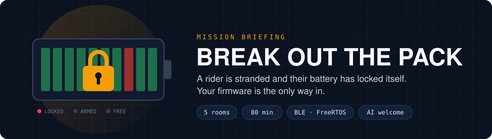
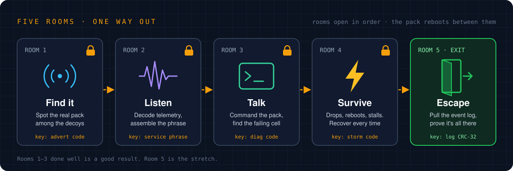
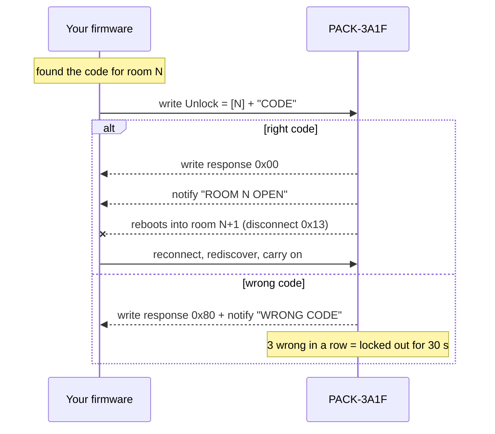

<p align="center"></p>

A rider is stranded. After a bad firmware update their battery pack locked
itself into maintenance mode, and it only opens up one room at a time. You're
writing the firmware for the bike's main controller (a BLE central) that talks
its way through five rooms and frees the pack.

Everything runs on your laptop: the firmware on FreeRTOS (POSIX port), the
pack as an emulator next to it. Use AI tools as much as you like. We care
about what you build and how you steer it, not how much you type.

---

## 🧰 1. Setup (before the interview, ~5 min)

**Install Docker.** Copy the block for your machine.

<details open>
<summary><b>macOS</b> (Homebrew)</summary>

```sh
brew install --cask docker
open -a Docker
```

Wait for the whale icon in the menu bar to stop animating. No Homebrew? Get
[Docker Desktop](https://www.docker.com/products/docker-desktop/) instead.
</details>

<details>
<summary><b>Linux</b> (Ubuntu / Debian)</summary>

```sh
curl -fsSL https://get.docker.com | sh
sudo usermod -aG docker $USER && newgrp docker
```
</details>

<details>
<summary><b>Windows</b> (admin PowerShell, then use WSL)</summary>

```powershell
wsl --install
winget install -e --id Docker.DockerDesktop
```

Restart, start Docker Desktop, then run everything below in your WSL (Ubuntu) terminal.
</details>

**Get the repo and build it once.** This downloads FreeRTOS and GoogleTest, so
it's slow the first time and quick on the day.

```sh
git clone https://github.com/skarper-ebike/ble-wp.git && cd ble-wp
docker compose build
docker build -f Dockerfile.test -t ble-wp-test .
docker compose up
```

✅ You should see the firmware find three devices and the pack say it has no
mission token. That's right: it stays locked until the interview. Ctrl+C to stop.

---

## 🚀 2. Start the mission (on the day)

Your interviewer gives you a token. **The clock starts when it's issued** and
keeps running whatever you do to the containers.

Open three terminals in the `ble-wp` folder.

**Terminal 1 · the pack.** Put your token in, start it once, leave it running.
Its log is your mission console: room banners, clock, what the pack sees.

```sh
echo MISSION=PASTE-TOKEN > .env
docker compose down
docker compose up -d --build emu && docker compose logs -f emu
```

**Terminal 2 · your firmware.** Run it again (Ctrl+C, ↑, Enter) after every change.

```sh
docker compose up --build --no-deps fw
```

**Terminal 3 · mission control.**

```sh
docker compose exec emu python3 ctl.py score
```

| Command | What it does |
|---|---|
| `ctl.py score` | Rooms opened, clock, hints taken |
| `ctl.py hint` | Next clue for your current room. **Costs 5 minutes** |
| `ctl.py drop` · `reboot` · `storm` · `corrupt` · `silent` | Break the pack yourself to test your firmware. Add seconds for a duration, e.g. `ctl.py silent 5` |

**Tests** (GoogleTest / GMock):

```sh
docker build -f Dockerfile.test -t ble-wp-test . && docker run --rm ble-wp-test
```

`BLE_TRACE=1 docker compose up --build --no-deps fw` prints every radio frame.
The pack also logs every frame to `logs/transcript.jsonl`.

<details>
<summary>Without Docker (Linux: CMake ≥ 3.22, GCC, Python ≥ 3.8)</summary>

```sh
MISSION=PASTE-TOKEN python3 emulator/emulator.py                      # terminal 1
cmake -S . -B build && cmake --build build && ./build/ble_wp           # terminal 2
python3 emulator/ctl.py score                                          # terminal 3
cmake -S . -B build-test -DBUILD_APP=OFF -DBUILD_TESTING=ON && cmake --build build-test && ctest --test-dir build-test
```
</details>

---

## 🔒 3. The rooms

<p align="center"></p>

Each room asks for a bit more firmware. Build it properly and the code falls
out. All the details are in [`docs/ICD.md`](docs/ICD.md).

### 📡 Room 1 · Find it
- **Build:** scanning, connect, service discovery, and writing to the Unlock characteristic.
- **The puzzle:** three devices are advertising and two of them aren't the pack you want. Work out which one is real, then find its code. See *Advertising* in the ICD.
- **Done when:** the console shows `ROOM 1 OPEN`. The pack then reboots, so your firmware has to find it and reconnect on its own.

### 〰️ Room 2 · Listen
- **Build:** rediscovery after the reboot (handles change), a telemetry subscription, and a decoder for the 20-byte frame with its CRC check. Print a one-line status each second: voltage, current, SoC, frames lost and bad.
- **The puzzle:** telemetry carries a 12-character phrase, a couple of characters at a time. Corrupt frames carry junk.
- **Done when:** your firmware writes the right phrase and the console shows `ROOM 2 OPEN`.

### ⌨️ Room 3 · Talk
- **Build:** the command channel. Requests with an ID, responses matched to them, a timeout, a retry, and handling every status code. You'll also need an MTU exchange.
- **The puzzle:** the pack refuses to help until you deal with its fault. Then find the failing cell and get its diagnostic code.
- **Done when:** `ROOM 3 OPEN`.

### ⚡ Room 4 · Survive
- **Build:** recovery. Reconnect with backoff, restore your subscriptions and state, and never hang or crash.
- **The puzzle:** none. The pack drops the link, reboots and stalls. Each time, it wants telemetry flowing again and a command answered **within 8 seconds** of you reconnecting. After three good recoveries it hands you the code on Unlock.
- **Done when:** `ROOM 4 OPEN`. `ctl.py score` shows recoveries as you go.

### 🚪 Room 5 · Escape (stretch)
- **Build:** a chunked download of the event log, sized to the MTU, that resumes after a drop.
- **The puzzle:** prove you have every byte. The code is the log's CRC-32.
- **Done when:** `PACK RELEASED`.

**Throughout:** keep the logic you'd want to test (decoders, the state machine) in `application_core` and write unit tests for it as you go.

---

## 🗝️ 4. Opening a room

Your **firmware** hands in each code. There's no other way in: you can't type
codes, and the interviewer can't either.



When a room opens, the mission console tells you:

```
###############################################################################
# ROOM 2 OPEN  (31:07 elapsed, 48:52 left)                                    #
# Telemetry link verified. After the next reboot the pack will take commands. #
###############################################################################
```

---

## 📜 Rules

- Your code goes in `src/application/` (and `tests/`). Don't change `src/ble/` or `emulator/`.
- Treat the pack as hardware you can't see inside. Don't read the emulator's code.
- Logic you want to unit test goes in `application_core` (no FreeRTOS in it). Task and queue glue goes in the firmware target.
- Commit as you go. We'll read the history.
- `CLAUDE.md`, `AGENTS.md` and `.claude/` set the rules for your AI tools. Leave them as they are.

## ⏱️ The session (~2 h)

| | |
|---|---|
| 10 min | We walk through this README and give you your token |
| 80 min | You build. The clock is on the pack |
| 30 min | You walk us through your code and decisions, then one small change live |

**Half your score is the rooms, half is the code and how you explain it.**
Nobody escapes every time: three rooms done well is a good result. Don't rush.

## 🗺️ Where to find things

| What | Where |
|---|---|
| The pack's BLE interface and the rooms | [`docs/ICD.md`](docs/ICD.md) |
| The BLE API you build on, and its rules | [`src/ble/ble_central.h`](src/ble/ble_central.h) |
| Starter application | [`src/application/app.c`](src/application/app.c) |
| BLE mock for unit tests | [`tests/mocks/ble_mock.h`](tests/mocks/ble_mock.h) |

```
├── docs/ICD.md            pack interface spec
├── src/
│   ├── main.c             scheduler bring-up
│   ├── application/       your code
│   └── ble/               BLE API + simulated stack (given)
├── tests/                 GTest + BLE mock
├── emulator/              the pack (given, don't read it)
├── Dockerfile             firmware
├── Dockerfile.test        unit tests
└── docker-compose.yml     firmware + emulator
```
